<div align="center">

# ResQ

### Swarm-Guided Rescue

**A phone scan of a real building becomes a live fire simulation. Four drones search it with their own sensors and an on-device Gemma model, re-plan when the building changes, then guide a firefighter to the survivor by voice and light.**


-4CC88B)


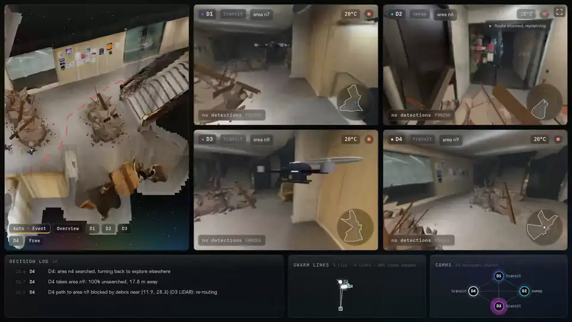

<sub>Act 1, 2× speed. Left: the 3D twin with an auto-director camera. Centre: each drone's camera, LiDAR and Gemma verdict. Bottom: every decision with the reading that caused it.<br>
▶ <a href="docs/media/full-run.mp4"><b>Watch the full uncut run (4 min, MP4)</b></a>: loading → Act 1 → a debris drop → Act 2 walk → mission complete.</sub>

</div>

---

## In one minute

- **The problem.** Being lost, caught or trapped is the second leading cause of firefighter deaths on the fireground (18.2%, USFA). Smoke takes away every visual reference, and nobody has a live picture of the building.
- **What we built.** A swarm goes in first. Four simulated drones explore a **digital twin made from an iPhone LiDAR scan** of the Marshgate building, find fire and a survivor **using only their own sensors**, then hold a chain of checkpoints along the safest route. A person walks that route in first person while the drones talk them through it, each in its own **Gemini** voice and personality.
- **Why you can trust what you see.** Every action is logged with the sensor reading behind it, and the code refuses to log an action without one. The swarm never sees ground truth, and a test fails the build if it tries. When the scene changes (someone clicks to drop debris, a drone is lost to heat), the drones find out through their LiDAR and cameras and re-plan on screen.
- **Where it runs.** One laptop. MuJoCo on the CPU, Gemma 4 E4B through a local Ollama server on an 8 GB laptop GPU, and nothing in the control loop that needs the internet.

## Highlights

- **Every decision cites what it perceived.** Each row in the decision log names its sensor and value, and uncertain detections trigger a closer look before anything is marked. [More](#1-every-decision-traces-to-a-sensor-reading)
- **The world changes, the swarm re-plans.** Debris dropped on the route is flagged by LiDAR **0.2 s** later; the old route turns red and a new one appears. A drone is lost mid-mission and its area is reassigned. [More](#2-the-world-changes-the-swarm-re-plans)
- **The deadliest failure, handled live.** A safe route goes unsafe while the firefighter is on it: "Stop. Route blocked." and a new route **0.5 s** later. [More](#3-why-it-matters)
- **Gemini gives the swarm a voice.** Each drone talks to the firefighter in its own Gemini TTS voice and personality, reworded live by Gemini and fact-checked against the swarm's beliefs, so the firefighter can tell the drones apart by ear in the smoke. [More](#4-gemini-gives-the-swarm-a-voice)
- **One laptop, careful when unsure.** Local Gemma, a measured edge budget, hard timeouts, and explicit rules for uncertainty. [More](#5-one-laptop-careful-when-unsure)
- **Phone scan → physics twin → coordinating swarm → a human guided through smoke**, backed by about 300 automated tests and an honesty test. [More](#6-from-a-phone-scan-to-a-guided-rescue)

---

## The demo, in two acts

<table>
<tr>
<td width="50%">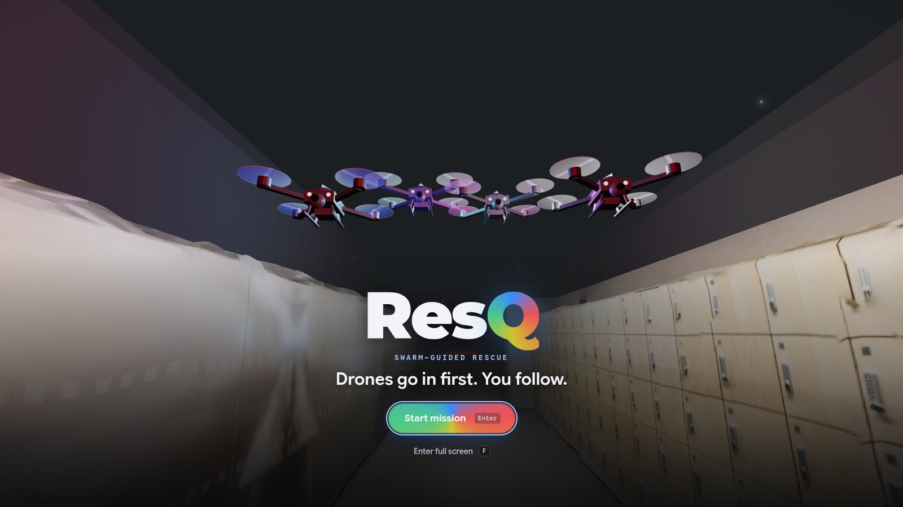</td>
<td width="50%">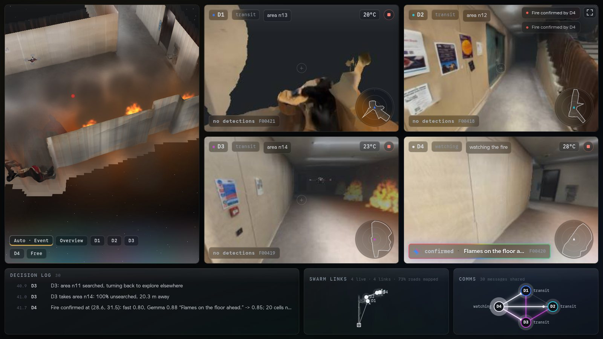</td>
</tr>
<tr>
<td><b>Deploy.</b> The ResQ start screen puts you in the firefighter's view at the entrance, the drones hovering overhead: <i>"Drones go in first. You follow."</i> Pressing <kbd>Start mission</kbd> sends them in.</td>
<td><b>Act 1: mission control.</b> The drones fan out, map the building, confirm four fires, lose one drone to a flare-up, find the survivor and form a relay chain.</td>
</tr>
<tr>
<td>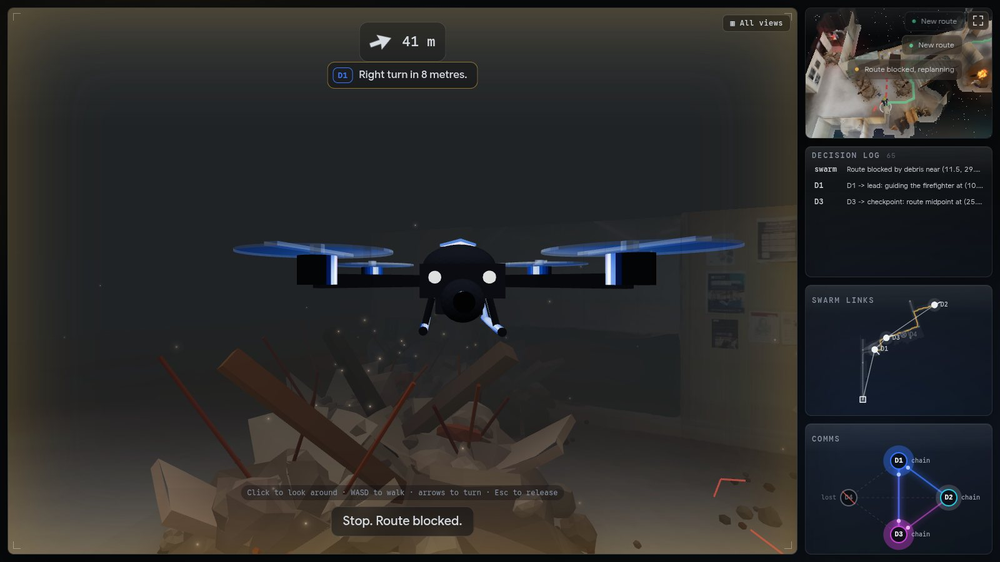</td>
<td>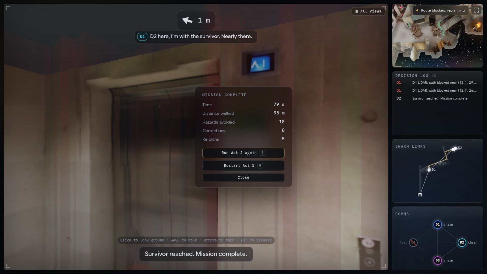</td>
</tr>
<tr>
<td><b>Act 2: the rescue.</b> A person walks the route in first person through about 4 m of visibility, following the lead drone, a heads-up arrow and spoken directions.</td>
<td><b>Mission complete.</b> Time, distance, hazards avoided, corrections and re-plans, with the full decision log beside it.</td>
</tr>
</table>

---

## 1. Every decision traces to a sensor reading


**No action without evidence.** Every swarm decision is a `TraceRow`: time, drone, action, a plain-English reason, and an `Evidence` record (sensor, value, camera frame id or LiDAR scan). `Trace.log` raises an error if the evidence or its value is missing, and the pydantic contract requires both. The dashboard shows every row, and rows with a camera frame or LiDAR scan link to it (`img` / `scan`).

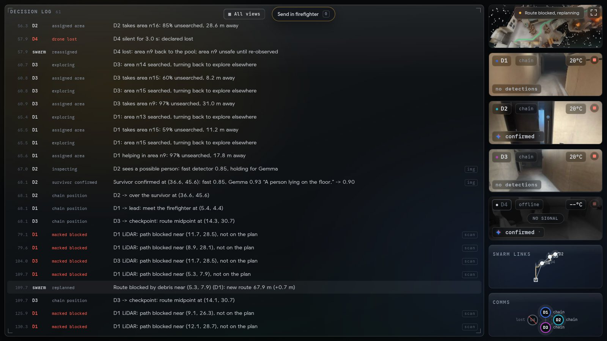

Real rows from the recorded run:

```text
34.7  D4     INSPECT            D4 sees possible fire: fast detector 0.80, holding for Gemma
35.7  D4     CONFIRM_HAZARD     Fire confirmed at (20.5, 28.8): fast 0.80, Gemma 0.88 "Flames on the floor ahead." -> 0.85; 20 cells no-go (+1 m margin)
57.9  D4     DRONE_LOST         D4 silent for 3.0 s: declared lost
57.9  swarm  REASSIGN           D4 lost: area n9 back to the pool; area n9 unsafe until re-observed
68.1  D2     SURVIVOR_CONFIRMED Survivor confirmed at (36.6, 45.6): fast 0.85, Gemma 0.93 "A person lying on the floor." -> 0.90
109.7 D1     MARK_BLOCKED       D1 LiDAR: path blocked near (5.3, 7.9), not on the plan
109.7 swarm  REPLAN             Route blocked by debris near (5.3, 7.9) (D1): new route 67.9 m (+0.7 m)
```

**Four sensors per drone, each with a job:**

| Sensor | Simulated how | What the swarm does with it |
|---|---|---|
| **Camera** (320×240, 90° FOV) | MuJoCo offscreen render of the textured scan, with fire composited in | Fast colour detector → Gemma check → fire or survivor marked; also decides which cells count as *searched* (in view, ≤5 m, line of sight) |
| **2D LiDAR** (36 rays, 6 m) | MuJoCo `mj_multiRay` against the collision walls | Updates the belief map. A hit 0.3 m shorter than the prior map, seen twice, marks `blocked_new` and triggers a re-plan |
| **Temperature** | Heat field around each fire | Above 50 °C marks danger cells, above 70 °C the drone retreats; readings also locate heat the cameras haven't seen |
| **Heartbeat** | Each drone's link to the blackboard | 3 s of silence → `DRONE_LOST`, area reassigned and marked unsafe |

**Seeing → checking → acting.** The perception pipeline is two-stage, so the swarm never acts on one weak reading:

1. **Fast detector** (OpenCV HSV thresholds, a few ms per frame) flags a *possible* fire or hi-vis survivor. A 348-pose sweep of the map produced zero false fires or persons.
2. **Gemma 4 E4B** gets the full frame with a fixed prompt and a JSON schema: `fire`, `person`, `confidence`, and a caption of at most 12 words.
3. **Fusion**: combined = 0.4·fast + 0.6·Gemma when they agree (0.3·fast when they don't). Confirmed at **≥ 0.7**.
4. **Correcting itself mid-run**: below 0.7 the drone holds, moves to about 2 m from the target and asks again (up to 2 re-looks). If Gemma doesn't answer in time, the finding stays `UNCONFIRMED` and the swarm gets a second view instead of guessing. A clear disagreement on a re-look rejects the detection (`REJECT_DETECTION`).

---

## 2. The world changes, the swarm re-plans


**Anyone can change the world mid-run.** Clicking the 3D map drops debris or starts a fire in the MuJoCo world, not in the swarm's memory. The drones find out the honest way: LiDAR change detection for debris, camera + Gemma + heat for fire.

<table>
<tr>
<td width="55%">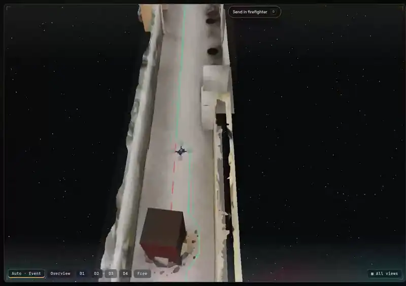</td>
<td>

**Recorded in Act 1** (real time):

- `109.5 s` debris dropped on the route, 3.2 m from D1
- `109.7 s` **D1 LiDAR**: path blocked, not on the plan
- `109.7 s` **REPLAN**: new route 67.9 m (+0.7 m)
- old route drawn **red and dashed**, new route green, checkpoints re-posted

Across a scripted sweep, 8 of 9 unscripted clicks were noticed **0.2–12 s** after placement. The one miss was debris under 0.3 m from a wall, which LiDAR can't tell apart from the wall itself.

</td>
</tr>
</table>

**Losing a drone, live.** Every run loses exactly one drone during exploration. Usually it's the drone watching the fire, caught by a scripted flare-up; the heat build-up beforehand is real. If no flare-up fits, a drone loses its signal instead. The swarm:

- declares it lost after **3 s** without a heartbeat (`DRONE_LOST`),
- puts its unexplored area back in the pool (`REASSIGN`),
- marks that area **unsafe until someone re-observes it**,
- rebuilds the checkpoint chain for three drones.

The lost drone's feed turns to *NO SIGNAL*, its node is struck through on the comms graph, and the planner routes around it. The dashboard also has a per-drone stop button for failing a drone on demand.

**Re-planning everywhere.** A* runs on a 0.2 m belief grid: walls inflated 0.3 m, fire plus a 1 m margin impassable, heat and wall proximity cost extra. When one drone's LiDAR sees debris on another's path, the re-plan cites `seen_by`. The comms view shows the message travelling between them.

<table>
<tr>
<td width="50%">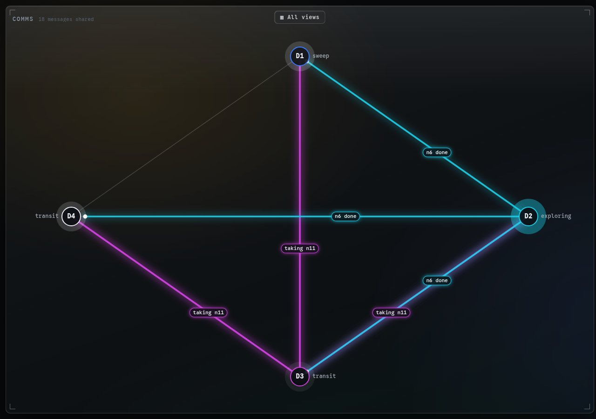</td>
<td width="50%">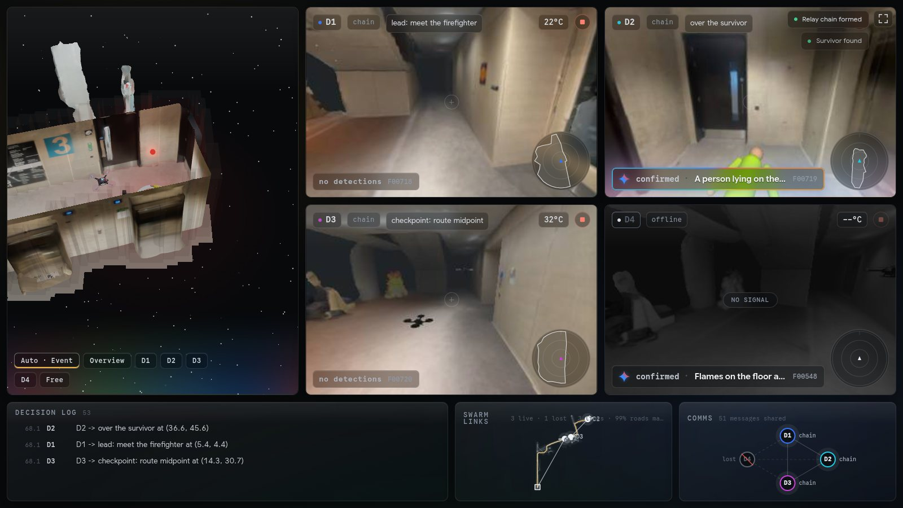</td>
</tr>
<tr>
<td><b>Comms, focused.</b> Each shared decision lights the link from sender to receivers, labelled with what was said ("taking n11", "n6 done", "fire confirmed").</td>
<td><b>Survivor found, chain formed.</b> D2 confirms the survivor (fast 0.85, Gemma 0.93) and hovers over them. D1 goes back to meet the firefighter, D3 takes the midpoint, D4 is offline.</td>
</tr>
</table>

---

## 3. Why it matters


**The need.**
- A US Fire Administration study of 1990–2000 found being **lost, caught or trapped** was the second leading immediate cause of fireground firefighter deaths, at **18.2%** ([Fire Engineering](https://www.fireengineering.com/firefighting/improving-situational-awareness-in-a-fire-structure/)).
- A NIOSH review found that between 1997 and 2001 **at least 20 firefighters died** and 5 were severely injured after becoming lost or disoriented inside burning structures, with poor visibility as the common thread ([NIOSH via CDC Stacks](https://stacks.cdc.gov/view/cdc/181198)).
- Large non-residential buildings, like the university building we scanned, make it worse: longer corridors, bigger floor plates, more ways to get turned around.

**The most critical failure mode: a safe route turning unsafe while the firefighter is on it.** We trigger it live in every Act 2 and the system handles it on screen:

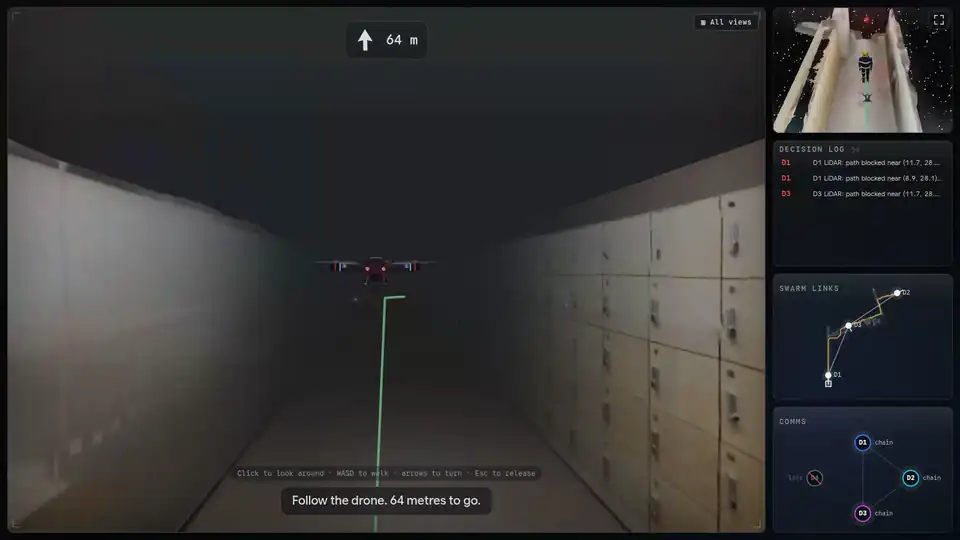

| Time (sim) | What happens |
|---|---|
| 127.8 s | Debris dropped on the route about 5.5 m ahead of the walking firefighter |
| 128.0 s | Checkpoint drones D3 and D1 detect it with LiDAR (`MARK_BLOCKED`) |
| 128.3 s | `REPLAN`: route blocked by debris, new route 43.3 m |
| on screen | **"Stop. Route blocked."**, then **"New route. Follow me."** with the arrow swinging to the new heading |

Three safeguards keep the firefighter out of danger:

- Checkpoint drones keep scanning their stretch of the route.
- Any new blockage on the route triggers an immediate stop and re-route.
- Guidance can't drive a drone back into heat: a drone at 60 °C or more stays under the swarm's control until it cools below 45 °C.

**Firefighter guidance rules** (plain code, instant, offline), highest priority first:

| Situation | Response |
|---|---|
| Walks into fire | Pushed back: *"Stop. Fire ahead. Turn back."* with red screen edges and an alarm tone |
| Within 1 m of a known fire | Danger warning |
| Route blocked ahead | *"Stop. Route blocked."* → new route → *"New route. Follow me."* |
| Heat on the route itself | *"Heat on the route. Keep moving."* |
| No safe route | *"No safe route. Holding."* |
| Wrong way (on an off-route branch, or heading more than 120° away from the next checkpoint, for 2 s) | *"Wrong way. Turn around."* |
| Drifting more than 2 m off route for 2 s | *"Bear left / right"*, arrow pulses |
| Falling more than 6 m behind | The lead drone (normally 3 m ahead) stops: *"Follow me."* |
| Within 2 m of the next checkpoint drone | That drone takes over the guiding |
| Within 1.5 m of the survivor | Mission complete |

**Why it matters beyond this demo.** The twin comes from a free phone app, not specialist kit, so any building could be pre-scanned in minutes as part of fire-safety planning. The same pattern of scouting with sensors, proving a route and guiding a human along it extends to earthquakes, gas leaks, flooded buildings and assistive navigation.

---

## 4. Gemini gives the swarm a voice

In Act 2 the firefighter can't read a map. They're in smoke, following lights and voices. **Gemini is what makes the drones sound like a rescue team rather than a sat-nav.**

| Use | Model | What it does | How it helped us |
|---|---|---|---|
| **A personality for each drone** | `gemini-3.5-flash-lite` | Rewords the drone's line in its own character, in about 0.5 s: D1 a calm team leader, D2 warm and encouraging, D3 upbeat and quick, D4 precise and softly spoken. Used for the intro, progress updates and "wait for me" / "coming back to you" lines | Guidance feels like a team talking you in, not a looped recording. The same facts come out in fresh words, so repeated instructions don't become background noise |
| **A distinct voice for each drone** | `gemini-3.8-flash-lite-tts` | Voices every drone line with its own prebuilt voice (D1 Charon, D2 Kore, D3 Puck, D4 Aoede) in about 2 s. The heads-up guidance lines get a calm "incident commander" voice (Orus), generated once at startup so they play instantly | With no visibility, the firefighter can tell **which drone** is speaking, and hear a handover from one checkpoint drone to the next, by voice alone |
| **Gemma: Gemini's open sibling, on-device** | `gemma4:e4b` via Ollama | Checks every fire or survivor candidate from the drone cameras and returns a verdict, a confidence and a short caption ("Flames on the floor ahead.") | Gave us Gemini-family vision with **no network**, inside the control loop, on an 8 GB laptop GPU. The captions go straight into the decision log as evidence |
| **Gemini design language** | — | The dashboard uses Gemini's four-point spark and colours to show AI at work: the spark on the loading screen, a Gemini-coloured glow on the 3D view and drone tiles while a Gemma check is running, the "confirmed" chip, the ring on the Start button, and the spark-coloured Q of the ResQ wordmark that turns with it | Viewers can see at a glance when the AI is thinking and what it decided |

**Built so a cloud model can never put the firefighter at risk:**

- **Facts first, words second.** Guidance decides *when* a drone speaks and *what the facts are*, from the swarm's beliefs only. Gemini only rewords. A fact check rejects any reworded line that adds a direction, number, drone or hazard that isn't in the facts, and the fixed line is used instead.
- **Never waits on the network.** Gemini runs on its own worker thread with hard deadlines: 2 s for wording, 4 s for speech, and lines queued for more than 3 s are spoken plainly. The sim loop and the swarm's decisions never depend on it.
- **Urgent lines skip the rewording.** Fire, survivor and handover lines go straight to the voice, and danger warnings ("Stop. Fire ahead. Turn back.") are never reworded at all.
- **Online / Offline switch.** In the firefighter view, <kbd>V</kbd> toggles between **Online · Gemini** voices and **Offline · text only**, where the HUD subtitle and the drones' speech bubbles carry every instruction with no network. Without an API key, the drones fall back to the browser's local voices, so the demo is never silent by accident.

---

## 5. One laptop, careful when unsure


**Edge budget.** Everything in the decision loop runs on **one laptop**:

| Component | Runs on | Budget | Measured |
|---|---|---|---|
| Physics + sensors (MuJoCo 3.17) | CPU | control loop **10 Hz** (0.1 s step, 20 × 5 ms substeps) | full tick with rendering: mean 23 ms, p95 35 ms |
| Drone cameras (320×240) | integrated / discrete GPU | one camera render per tick | 18.6 ms mean, 25 ms p95 with fire in view |
| Fast detector (OpenCV) | CPU | every frame | a few ms |
| **Gemma 4 E4B** via Ollama | **RTX 5060 Laptop, 8 GB** | **≤ 12 s hard timeout**, never blocks the loop | +4.7 GB VRAM · p50 4.7 s / p95 5.3 s on the bench · p50 7.8 s / p95 8.3 s on the demo laptop with the 3D view running |
| Swarm planning + guidance | CPU, same process | every tick | inside the tick budget |
| **Network calls in the control loop** | — | **0** | the sim, swarm, perception and HUD guidance all run offline |

<sub>Model choice: the hour-one bench (`sgr/perception/bench/bench_results.md`) compared E4B (26/30 correct, p95 5.3 s) against E2B (20/30, p95 3.4 s, and it called the decoy a fire every time). We chose accuracy. With thinking turned off, Gemma answers in about 35 tokens per frame instead of about 645.</sub>

**When it is unsure, it behaves conservatively:**

| Situation | What the swarm does |
|---|---|
| Combined confidence < 0.7 | Hold, move closer (about 2 m standoff), look again, up to 2 re-looks. Nothing is marked on one weak reading |
| Gemma slow or down | Hard deadline on a separate worker thread; the result is `UNCONFIRMED` and the swarm gets a second view. The sim never waits |
| Still unsure after re-looks | `REJECT_DETECTION`: logged with its evidence, not acted on |
| Contact lost with a drone | Its last area is **unsafe until re-observed** |
| Temperature > 70 °C | Retreat at least 3.5 m to cooler cells and mark a danger zone |
| No safe route exists | `NO_ROUTE`: hold, re-check every 2 s, and send a drone to look at the blockage again |
| Drone running hot during Act 2 | At 60 °C or more, guidance stops steering it until it cools below 45 °C |

**The one network feature: Gemini voices.** The Act 2 drone voices ([§4](#4-gemini-gives-the-swarm-a-voice)) are the only part that uses the internet, and they sit outside the control loop. For a run with **no network at all**, switch the firefighter view to *Offline · text only* (<kbd>V</kbd>) or start with `--voice template` (fixed lines, local browser voices).

---

## 6. From a phone scan to a guided rescue


**Real-to-sim in an afternoon.**

<table>
<tr>
<td width="40%">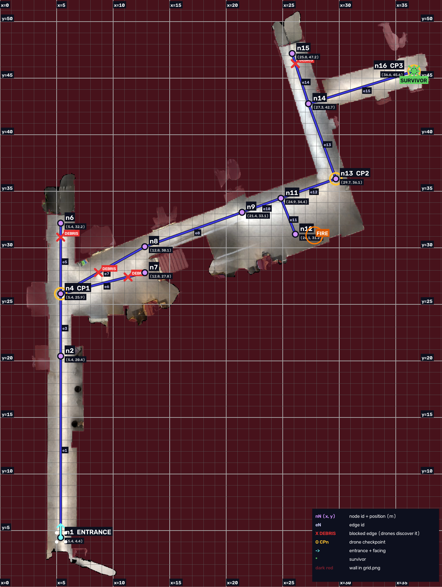</td>
<td>

1. **Scan** a route through the Marshgate building with an iPhone Pro's LiDAR (Scaniverse, free).
2. **`tools/prepare_scan.sh`** turns the raw scan into `scan.glb` for the dashboard and `sim.glb` for the cameras.
3. **`tools/scan_to_grid.py`** slices it into a 0.1 m occupancy grid. **`walls.py`** greedily merges wall cells into a small set of MuJoCo collision boxes (a scanned mesh would collide as one convex lump).
4. **`tools/scan_to_mujoco.py`** builds a textured replica that only the cameras see, so the drones' images look like the real building.
5. **`tools/scan_route_draw.py` / `propose_graph.py`** build the route graph, and the editor at `/editor` places fires, debris and the survivor. `scan_check_scenario.py` checks it all with the real planner.

The result: a **39 × 52 m** twin with 13 route nodes, 4 fires, 4 debris piles, a survivor and a scripted flare-up.

</td>
</tr>
</table>

**Engineering we're proud of:**

- **Honest by construction.** `tests/test_honesty.py` greps `sgr/swarm` and `sgr/guidance` for any use of ground truth (comments included), forbids the swarm from importing the world or perception internals, and checks that every trace row carries evidence. The swarm learns only through `Readings` and `Detection`s.
- **Contracts as the only shared surface.** One pydantic file (`sgr/contracts.py`, version 5) mirrored in TypeScript (`web/src/contracts.ts`). Four people built four packages in parallel against facades (`World`, `Perception`, `Swarm`, `Guidance`).
- **Robust under stress.** Sweeps over Gemma latency (1–11 s) × start positions: **18/18** marshgate runs complete every beat, plus 9/9 on the test map. Peak drone heat fell from 409–521 °C to ≤ 162 °C after heat-aware planning.
- **Tested.** About 300 `pytest` tests (`uv run pytest -q`), including a kinematic `FakeWorld` so the swarm can be developed without MuJoCo, a replay tool that scripts live-demo actions, and a smoke test that gates every merge.
- **A dashboard built for live demos.** A 3D twin with an auto-director camera that glides to events, live drone feeds with LiDAR minimaps and Gemma verdicts, a decision log you can expand, a swarm-links map, a comms graph, and a first-person firefighter view, all running in the browser with three.js.

<table>
<tr>
<td width="50%">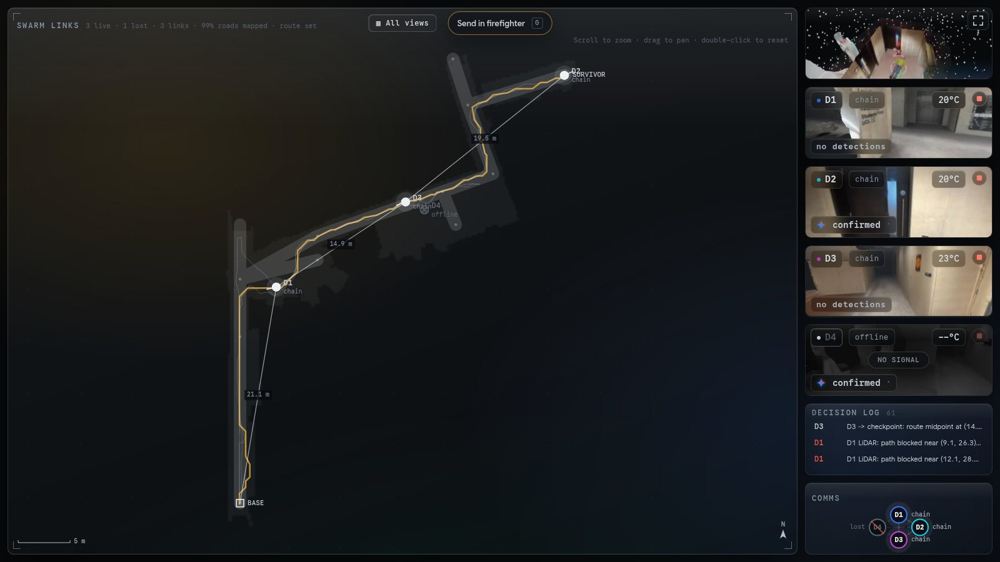</td>
<td width="50%">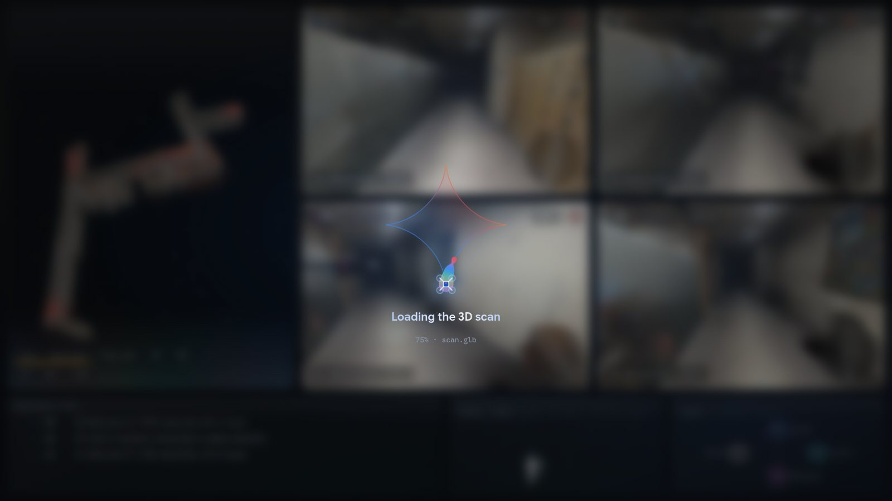</td>
</tr>
<tr>
<td><b>Swarm links.</b> Relay tree from the entrance to each drone over the mapped route graph. It's a visual aid, not a simulated radio.</td>
<td><b>Start-up.</b> The dashboard stays behind a loading cover until the sim, scan and models are ready, then holds the sim at t = 0 on the ResQ start screen. Refreshing there re-arms in a few seconds.</td>
</tr>
</table>

---

## Architecture

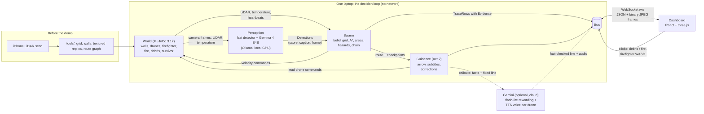

| Package | Role | Owner |
|---|---|---|
| `sgr/world/` | MuJoCo world: grid → walls, drones, firefighter body, LiDAR, cameras, fire and debris pools, heat | Ashraya |
| `sgr/perception/` | `mock` / `remote` / `local` perception, fast detector, Gemma client, fusion, budget probe | Ashraya |
| `sgr/swarm/` | Blackboard, belief grid, area assignment, A*, hazards, drone loss, rescue chain, decision trace | Yash |
| `sgr/guidance/` | Act 2: firefighter guidance rules, handover, corrections, summary, drone voices | Ashraya |
| `sgr/loop.py`, `sgr/app.py`, `sgr/bus.py`, `sgr/contracts.py` | 10 Hz sim loop, entry point, thread-safe queues, shared contracts | Yash |
| `sgr/server/`, `web/` | FastAPI + WebSocket server, React + three.js dashboard and firefighter view | Helitha |
| `tools/`, `maps/`, `web/src/editor/` | Scan pipeline, route graph, scenario editor, disaster dressing | Jeson |

---

## Repository layout

```text
sgr/
  app.py  loop.py  bus.py  contracts.py  config.py  snapshot.py
  world/        MuJoCo World facade (+ fake_world.py, kinematic, for tests)
  perception/   mock | remote | local, fast detector, Gemma, fusion, budget, bench/
  swarm/        blackboard, belief, areas, planner, hazards, rescue chain, trace
  guidance/     Act 2 rules, voices
  server/       FastAPI + WebSocket /ws
web/            React + three.js dashboard, firefighter view, route editor (/editor)
tools/          scan pipeline, route graph, test map, replay, debugging
maps/           marshgate-route (demo), synthetic, test
tests/          smoke, contracts, honesty, swarm, perception, guidance, replay, ...
docs/media/     README images and clips (captured from a real run)
```

---

## Limits we state openly

- **Simulation, not hardware.** One floor at a fixed flight height, drones driven by velocity actuators (no rotor physics), and no real radio limits. Not yet tested on real drones.
- **No microphone.** The original plan had drones follow the survivor's voice; it was cut for time. Survivors are found by camera.
- **Simplified fire.** Four fixed fires plus one scripted flare-up; fire doesn't spread.
- **Colour-based fast detector.** It depends on how fire and the hi-vis survivor are rendered, which is why Gemma checks every candidate.
- **Gemma latency.** Seconds per check, not milliseconds. The swarm is designed around it (hard deadlines, `UNCONFIRMED`, second views), but it slows confirmations. Gemma also misses the survivor from some angles (11 of 12 correct in our prompt tests).
- **Debris within 0.3 m of a wall** can't be told apart from the wall by LiDAR.
- **The edge budget is measured in the backend but not shown on the dashboard** in this build. The measured numbers are in the table above.
- **The firefighter's position in Act 2 comes straight from the sim** (standing in for a body-worn tracker); the drones still only learn about hazards through their sensors.
- **Screens and clips in this README** were captured with `--perception mock` (scripted Gemma answers with simulated latency), so they could be recorded on a machine without the demo GPU.

---

## How to run

**Requirements:** Python 3.12, [uv](https://docs.astral.sh/uv/), Node 22. For real perception: [Ollama](https://ollama.com) with `gemma4:e4b` and a GPU with about 5 GB free.

```bash
# 1. Python deps
uv sync

# 2. Build the dashboard (the server serves web/dist)
cd web && npm install && npm run build && cd ..

# 3. Run the demo map with mock perception (no GPU needed)
uv run sgr --map maps/marshgate-route --perception mock --voice template
#    → open http://127.0.0.1:8000, wait for the ResQ start screen, press Start mission
```

**With real, on-device Gemma (the demo setup):**

```bash
ollama pull gemma4:e4b
uv run sgr --map maps/marshgate-route --perception local --voice template
```

**With Gemini drone voices:** put your key in `.env` as `GOOGLE_API_KEY=...` (or `GEMINI_API_KEY`) and run with `--voice auto` (the default) or `--voice gemini`. The console prints which Gemini models are voicing the drones.

```bash
uv run sgr --map maps/marshgate-route --perception local --voice gemini
```

**The start screen.** While the sim connects and the 3D scan loads, a loading cover shows a drone flying around the Gemini spark. When everything is ready, the sim is held at t = 0 and the **ResQ** start screen appears: the firefighter's view from the entrance with the drones overhead, the tagline *"Drones go in first. You follow."*, and:

- **Start mission** (<kbd>Enter</kbd>) fades onto the dashboard and runs Act 1.
- **Enter full screen** (<kbd>F</kbd>) goes full screen before you start (it becomes *Exit full screen* once you're in). Best for a live demo or a recording.
- If you open the page on a run that's already under way, it says **Mission paused** and offers **Resume mission** (<kbd>Enter</kbd>) or **Restart mission** (<kbd>R</kbd>, back to the start of Act 1).
- Refreshing the page on the start screen is safe: the sim stays paused and the screen is ready again within a few seconds.

**In the dashboard:**

| Key / action | What it does |
|---|---|
| <kbd>Enter</kbd> / <kbd>R</kbd> | Start screen: start (or resume) the mission / restart Act 1 when resuming |
| Click a tile | Focus it (<kbd>Esc</kbd> to go back) |
| Click tool on the 3D map | Drop debris or start a fire anywhere; the drones only find out through their sensors |
| ■ on a drone feed | Fail that drone (it loses its signal) |
| <kbd>G</kbd> | Send in the firefighter (Act 2), once the chain is in position |
| <kbd>W</kbd><kbd>A</kbd><kbd>S</kbd><kbd>D</kbd>, arrows, mouse | Walk and look in the firefighter view |
| <kbd>V</kbd> | Firefighter view: toggle Online · Gemini voices / Offline · text only |
| <kbd>F</kbd> | Full screen, anywhere (also the button on the start screen and the top-right corner of the dashboard) |

**Useful flags:** `--speed 2.5` (faster for video), `--no-render` (no camera rendering), `--no-server --max-ticks 600` (headless), `--voice auto|gemini|template|off`.

**Tests:** `uv run pytest -q`

---

## Team

Built in a weekend by a team of four for the AgentVerse 2026 Robotics Track, each owning one slice of the system through shared contracts:

| Who | Owns |
|---|---|
| **Jeson**: World & Scan | iPhone scan → twin pipeline, route graph, scenario editor, disaster dressing |
| **Yash**: Swarm & Integration | Swarm brain, sim loop, contracts, replay, merge gate |
| **Ashraya**: Perception & Sim core | MuJoCo world, fast detector, Gemma, fusion, Act 2 guidance and Gemini voices |
| **Helitha**: Dashboard & 3D | Server, mission-control dashboard, 3D twin view, firefighter view |

On GitHub: Jeson [@JesonRamesh](https://github.com/JesonRamesh) · Ashraya [@ashrayap-web](https://github.com/ashrayap-web) · Yash [@yash-joshi5379](https://github.com/yash-joshi5379) · Helitha [@ItzSmudge](https://github.com/ItzSmudge)

## Sources

- [Fire Engineering: Improving Situational Awareness in a Fire Structure](https://www.fireengineering.com/firefighting/improving-situational-awareness-in-a-fire-structure/) (USFA lost/caught/trapped statistic)
- [NIOSH review of firefighter structure fire fatality investigations, via CDC Stacks](https://stacks.cdc.gov/view/cdc/181198)
- Gemma bench: [`sgr/perception/bench/bench_results.md`](sgr/perception/bench/bench_results.md)
- Build spec: [`.plans/swarm-guided-rescue-build-spec.md`](.plans/swarm-guided-rescue-build-spec.md)
